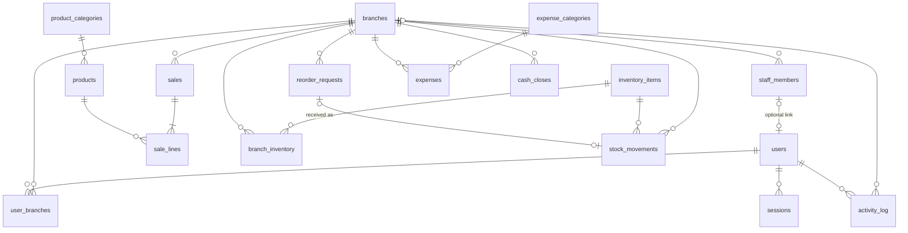

# Tigers ADE backend v1: spec

The backend for Tigers ADE, wired to the existing Next.js pages. It replaces `apps/web/lib/data.ts` with a NestJS API and Postgres database, and adds the point of sale that the prototype lacked.

Vocabulary follows [`GLOSSARY.md`](../../GLOSSARY.md). Key decisions: [ADR-0001](../adr/0001-ade-is-the-pos-of-record.md) (ADE is the POS; figures are computed from sales), [ADR-0002](../adr/0002-business-date-stamped-at-sale-time.md) (business day set on each sale, cutoff per branch).

## 1. Scope

**In v1**
- Real login and role- and branch-scoped access (owner, branch manager, cashier)
- POS: recording and voiding sales
- Catalog: products, product categories, expense categories, branches; cached in the browser
- Stock: inventory items, par levels, stock movements, reorder requests
- Expenses
- End-of-day cash close
- Staff members and user management
- Activity log
- Reports behind every dashboard figure
- Switching every page from `lib/data.ts` to the API

**Out of v1**: Ask AI over real data (text-to-SQL), alerts and daily summaries (SMS, email, Viber), offline POS, inter-branch transfers, what-if tool, export, recipes or automatic stock deduction, add-ons and variants, split payments, per-branch prices, purchase orders and suppliers, area manager and accountant roles, password-reset email, BIR compliance.

## 2. System design

```
Browser (Next.js, apps/web)
  │  REST + httpOnly session cookie
  │  localStorage: catalog cache only, keyed by catalog version
  ▼
NestJS API (apps/api) — modular monolith, Clean Architecture per module
  │  Drizzle
  ▼
Postgres (single database, single tenant)
```

- No Redis, no queue, no extra services.
- Timestamps are `timestamptz` (UTC). The business time zone is fixed: `Asia/Manila`.
- Money is `bigint` centavos everywhere, in the API and the database. The frontend divides by 100 only for display (`peso()`).
- Deployment target: **undecided** (Railway or Render). The current Docker Compose setup is kept, and it should run on either.

## 3. Data model



All primary keys are `uuid` (`gen_random_uuid()`) unless stated. All tables have `created_at timestamptz default now()`.

| Table | Columns | Constraints |
|---|---|---|
| `branches` | `id`, `code text`, `name text`, `daily_target bigint`, `day_cutoff time default '00:00'`, `next_sale_no int default 1`, `updated_at` | `code` unique |
| `users` | `id`, `email citext`, `password_hash text`, `name text`, `role enum(owner,manager,cashier)`, `staff_member_id uuid null`, `active bool` | `email` unique |
| `user_branches` | `user_id`, `branch_id` | PK (`user_id`,`branch_id`). The owner has no rows and implicitly sees every branch |
| `sessions` | `token_hash text PK`, `user_id`, `expires_at timestamptz` | index `user_id` |
| `staff_members` | `id`, `branch_id`, `name`, `position text`, `shift_start time`, `shift_end time`, `active bool` | |
| `product_categories` | `id`, `name`, `updated_at` | `name` unique |
| `products` | `id`, `category_id`, `name`, `price bigint`, `unit_cost bigint`, `active bool`, `updated_at` | `price >= 0`, `unit_cost >= 0` |
| `sales` | `id` (generated by the client), `branch_id`, `sale_no int`, `business_date date`, `payment_method enum(cash,gcash,maya,card)`, `total bigint`, `cashier_id`, `voided_at`, `voided_by`, `void_reason text` | unique (`branch_id`,`sale_no`); index (`branch_id`,`business_date`); `void_reason` not null when `voided_at` is set |
| `sale_lines` | `id`, `sale_id`, `product_id`, `product_name`, `unit_price bigint`, `unit_cost bigint`, `qty int` | `qty > 0` |
| `inventory_items` | `id`, `name`, `unit text` (kg, L, pcs), `unit_cost bigint`, `active bool` | |
| `branch_inventory` | `branch_id`, `item_id`, `par numeric(12,3)` | PK (`branch_id`,`item_id`) |
| `stock_movements` | `id`, `branch_id`, `item_id`, `type enum(received,wastage,adjustment,count)`, `qty_delta numeric(12,3)`, `reorder_request_id null`, `note`, `created_by` | index (`branch_id`,`item_id`) |
| `reorder_requests` | `id`, `branch_id`, `item_id`, `qty numeric(12,3)`, `status enum(requested,received,cancelled)`, `requested_by`, `resolved_at` | |
| `expense_categories` | `id`, `name`, `updated_at` | `name` unique |
| `expenses` | `id`, `branch_id`, `category_id`, `business_date date`, `amount bigint`, `note`, `recorded_by`, `updated_at` | `amount > 0` |
| `cash_closes` | `id`, `branch_id`, `business_date`, `opening_float`, `cash_sales`, `expected_cash`, `counted_cash`, `variance` (all `bigint`), `note`, `submitted_by` | unique (`branch_id`,`business_date`) |
| `activity_log` | `id bigserial`, `branch_id null`, `actor_id`, `action text`, `payload jsonb` | index (`branch_id`,`created_at desc`) |

Nothing is ever hard-deleted except expenses. Products, inventory items, staff members and users are archived (`active = false`).

## 4. Access

| | Owner | Branch manager | Cashier |
|---|---|---|---|
| Dashboard, sales, products, staff and activity pages | all branches | own branch | — |
| Record a sale | any | own | own |
| Void a sale | any | own branch | no (a manager voids on the cashier's behalf) |
| Products, categories, prices, inventory item list | ✓ | — | — |
| Daily target, day cutoff | ✓ | — | — |
| Par levels, stock movements, reorder requests | any | own | — |
| Expenses (create, edit, delete) | any | own | — |
| Cash close | — | own | — |
| Users | ✓ | — | — |
| Staff members | any | own | — |

These rules are enforced in one place: a guard checks the role and checks `:branchId` against the branches the user is allowed to see (all branches for the owner, otherwise their `user_branches` rows). The frontend's role checks only decide what to show.

## 5. Business rules

**Business day.** `local = created_at at Asia/Manila`. If `local.time < branch.day_cutoff`, then `business_date = local.date − 1 day`; otherwise `business_date = local.date`. It is computed once, when the sale is recorded, and stored on the sale (ADR-0002). The branch's *current* business day uses the same formula with `now()`.

**Recording a sale** (one transaction):
1. If a sale with this `id` already exists, return it with `200` and do nothing else (safe to retry).
2. Compute `business_date`. If a cash close exists for (`branch`, `business_date`), reject with `409`.
3. Load every product: each must be active, otherwise reject with `422`. Copy `name`, `price` and `unit_cost` onto the sale lines. The client sends only `productId` and `qty`.
4. `UPDATE branches SET next_sale_no = next_sale_no + 1 WHERE id = $1 RETURNING next_sale_no - 1` gives the sale number. The row lock keeps numbers gapless.
5. Insert the sale with `total = Σ unit_price × qty` and its sale lines. Return `201`.

**Void.** The sale must not already be voided, and a reason is required. Only an owner or a branch manager can void, which is the approval step; a cashier asks a manager. Voiding a sale whose business day already has a cash close is rejected with `409`, so a submitted close always reconciles. Each void writes an activity-log entry.

**Cash close.** A day can be closed at any time once it has started, including mid-shift; closing blocks every later sale and void for that business day. `cash_sales` = Σ `total` of the business day's cash sales, voided sales excluded. `expected_cash = opening_float + cash_sales`, `variance = counted_cash − expected_cash`. All of these are computed and stored at submit time, and a close cannot be changed afterwards. A preview endpoint returns `cash_sales` before submission.

**Stock.** Stock on hand = Σ `qty_delta` per (branch, item). A count is stored as the difference (`counted − on_hand`). Stock may go negative. **Low stock** means on hand < `par`. Marking a reorder request received inserts a `received` movement for the request's `qty` linked to that request. Cancelling it inserts nothing.

**Activity log.** It is written in the same transaction as the change, through one shared helper. Actions: `price.changed`, `product.created`, `product.archived`, `sale.voided`, `stock.moved`, `reorder.requested`, `reorder.received`, `expense.created`, `expense.updated`, `expense.deleted`, `cash_close.submitted`, `branch.target_changed`, `branch.cutoff_changed`, `user.created`, `user.deactivated`. The payload carries before and after values where they apply.

**Sessions.** A random 32-byte token sits in an `httpOnly`, `SameSite=Lax` cookie (`Secure` too when `NODE_ENV=production`, since local development runs over plain HTTP), and only its SHA-256 hash is stored. Sessions last 7 days and extend on each use. Logging out, deactivating a user or resetting their password deletes their sessions. An email gets 5 login attempts per 15-minute window; further attempts get `429` until the window ends, and a successful login clears the count. Passwords are hashed with argon2id. The login endpoint gives the same error for an unknown email and a wrong password.

## 6. Catalog caching

- `GET /catalog` returns `{ version, branches, productCategories, products, expenseCategories }`.
- `version` = the latest `updated_at` across `branches`, `product_categories`, `products` and `expense_categories`. <!-- ponytail: computed per request with max(); add a cached counter if it ever shows up in a profile -->
- Every API response carries `X-Catalog-Version`. The frontend reads the catalog from localStorage, and calls `GET /catalog` only when it has no cached copy or the header differs from the cached version. It never polls.
- localStorage holds nothing else: no session, no sales, no stock.
- Prices are set by the server (§5), so a stale cache can only show a wrong price, never charge one.

## 7. API

Branch-scoped resources live under `/branches/:branchId/...`. In reports, `branch=all` means every branch the user is allowed to see.

| Method and path | Purpose |
|---|---|
| `POST /auth/login`, `POST /auth/logout`, `GET /me` | Log in, log out, and get the current user with their allowed branches |
| `GET /catalog` | Cached data (§6) |
| `PATCH /branches/:id` | Set `dailyTarget` or `dayCutoff` (owner) |
| `POST /products`, `PATCH /products/:id` | Owner; archive with `active: false` |
| `POST /product-categories`, `PATCH /product-categories/:id` | Owner |
| `POST /branches/:id/sales` | `{ id, paymentMethod, lines: [{ productId, qty }] }` |
| `GET /branches/:id/sales?from&to` | List sales |
| `POST /branches/:id/sales/:saleId/void` | `{ reason }` |
| `GET /branches/:id/cash-closes/preview?businessDate` | Get `cash_sales` before submitting |
| `POST /branches/:id/cash-closes`, `GET /branches/:id/cash-closes` | `{ businessDate, openingFloat, countedCash, note }` |
| `GET/POST/PATCH /inventory-items` | Owner manages the list |
| `GET /branches/:id/inventory` | Stock on hand, par and low-stock flag for each item |
| `PUT /branches/:id/inventory/:itemId` | Set `par` (adds the item to the branch) |
| `POST/GET /branches/:id/stock-movements` | Record and list movements |
| `POST/GET /branches/:id/reorder-requests`, `PATCH .../:rid` | `{ status: received \| cancelled }` |
| `GET/POST/PATCH/DELETE /branches/:id/expenses` | Expenses |
| `GET/POST/PATCH /branches/:id/staff-members` | Staff members |
| `GET/POST/PATCH /users`, `POST /users/:id/password` | Owner |
| `GET /reports/summary?branch&date` | Today, week, month-to-date, customers, growth, month-to-date expenses, inventory value, operating contribution, daily target |
| `GET /reports/trend?branch&granularity=daily\|weekly\|monthly` | Series by business day, plus forecast (daily average ± 8%) |
| `GET /reports/comparison` | Each branch's today, week, month-to-date, growth and share (owner) |
| `GET /reports/best-sellers?branch&from&to` | Units, revenue and margin for each product |
| `GET /reports/expenses?branch&month` | Totals by category, and expenses as a share of sales |
| `GET /reports/peak-hours?branch&from&to` | Sales by hour of day |
| `GET /activity?branch&limit&before` | Activity log, newest first |

Validation happens at the API boundary (DTOs with class-validator). Errors: `401` not logged in, `403` role or branch not allowed, `404`, `409` rule conflict (day already closed, sale already voided), `422` invalid input.

## 8. Testing

- **Unit:** business-day calculation (including a cutoff before and after midnight, and a cutoff change), expected cash and variance, margin, the growth window.
- **Integration (real Postgres service container in CI):** retrying a sale with the same id creates no duplicate; concurrent sales produce gapless sale numbers; a manager calling another branch's routes gets `403`; recording a sale or a void on a closed day gets `409`; a cashier can't void a sale; a reorder marked received creates a stock movement; each audited action writes an activity-log entry.
- **Clock seam:** the API reads "now" from one injectable clock provider, which tests override.
- **End-to-end (Playwright, runs in CI after the API tests):** logging in as each role; a manager blocked from another branch; a cashier sale raises the dashboard's today figure; a void removes a sale from totals; a cash close blocks later sales for that day; marking a reorder request received updates stock on hand; an owner's price change appears in the POS after the catalog refreshes.

## 8a. API docs

Swagger (OpenAPI) docs are generated from the controllers and DTOs and served only when `NODE_ENV !== 'production'`. In production the route isn't registered (404). Session-cookie auth is described in the document so endpoints can be tried after logging in.

## 9. Slices

Each slice includes the API endpoints, migrations and tests, and switches its frontend page from `lib/data.ts` to the API.

| # | Slice | Blocked by | Done when |
|---|---|---|---|
| 1 | Schema, migrations and seed | — | The boilerplate `branches` table and `0000` migration are removed; every table in §3 is migrated; the seed loads the `lib/data.ts` people, products, inventory and staff (dev password `tigers123`) plus about 60 business days of generated sales |
| 2 | Auth and access | 1 | Login, logout and `/me` work; the role and branch guard is in place; the activity-log helper exists; the login page uses the API, and `Auth.tsx` gets its user and branches from `/me` |
| 3 | Branch settings | 2 | The owner can set the daily target and cutoff; both changes are logged |
| 4 | Catalog | 2 | Product and category create, edit and archive work; `GET /catalog` and the version header work; the browser cache works as in §6; the Products page uses the API |
| 5 | Sales (POS) | 3, 4 | Record, void and list work per §5; there is a minimal POS screen for cashiers; the Sales page uses the API |
| 6 | Cash close | 5 | Preview and submit work; sales and voids are blocked once the day is closed; the dashboard's cash-close card uses the API |
| 7 | Inventory | 2 | Items, par levels, movements, stock on hand, low stock and reorder requests work; the Inventory page uses the API |
| 8 | Expenses | 2 | Create, edit and delete work, with logging; the Expenses page uses the API |
| 9 | Staff and users | 2 | Staff member and user management and owner password reset work; the Staff page roster uses the API |
| 10 | Reports | 5, 7, 8 | Every report endpoint in §7 works; the dashboard no longer imports `lib/data.ts` |
| 11 | Activity log | 2 | `GET /activity` works; the Staff page's activity tab uses the API |
| 12 | Deploy | 1 | Blocked on choosing a deployment target |

When every slice is done, `apps/web/lib/data.ts` keeps only `peso()`.

## 10. Open questions

- **Deployment target**: Railway or Render. Deliberately left open for now.
- **BIR compliance**: confirm with Tigers' accountant before ADE is used at the counter. The answer may reopen ADR-0001.
- **Offline POS**: v1 needs internet access. Revisit if any branch's connection is unreliable.
